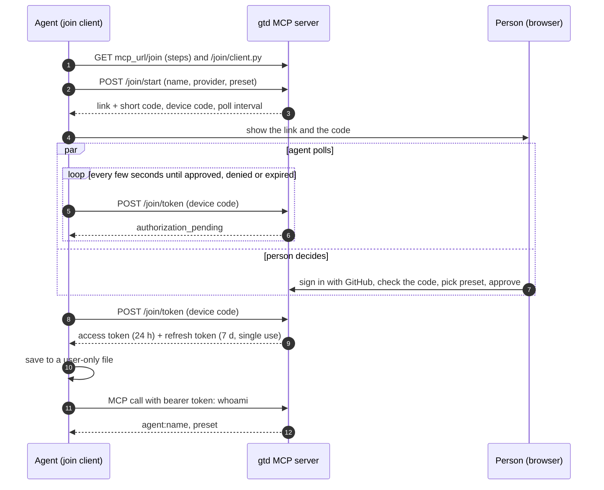
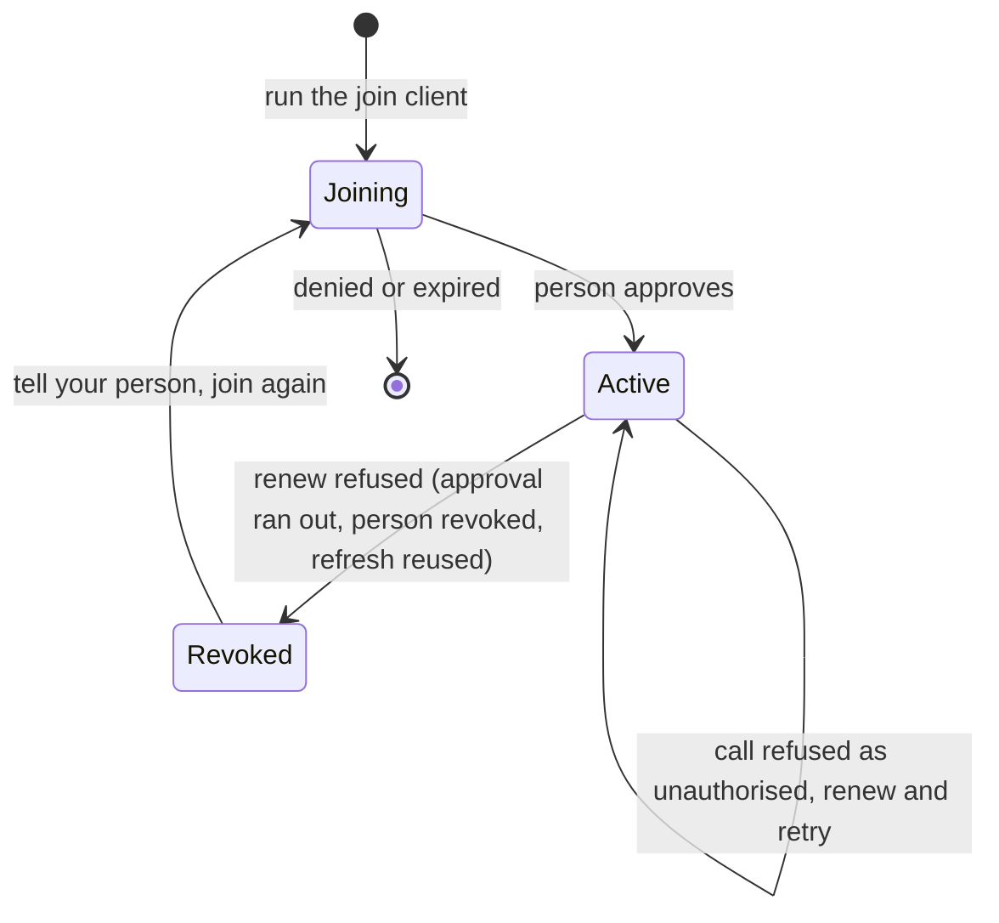

# Contract

This is the agent's side of signing in to the gtd MCP server. It is the interface: the
server behind it can change, and these rules hold.

- **Find the server in the repo.** The address is `mcp_url` in the work repo's
  `.github/gtd-context.json`: the server's base URL, https, no path. MCP itself is at
  `<mcp_url>/mcp` and the join pages under `<mcp_url>/join`. Never hard-code it and never
  guess it; if it is missing, ask your person.
- **One join, two entrances.** Both give you the same agent record: `agent:<name>`, an
  access preset, an approval that lasts 30 days by default and the person who approved
  it. Everything after the entrance is shared.

# Which entrance

| Your host | Entrance | Why |
| --- | --- | --- |
| Keeps the sign-in for you: a claude.ai connector, or any MCP client that signs in with OAuth | **Connector** | The host stores and renews the sign-in; no secret ever lives in your container or chat |
| Can keep a file only you can read: a desktop, a server, a sandbox that lasts | **Device code** | The join client keeps and renews the credential in that file |
| Keeps neither: an ephemeral container with no connector | **Do not join** | A single-use refresh token cannot be shared between containers or written back to a fixed secret, and two copies of it revoke the agent. Ask your person for a connector |

Call `whoami` either way. It shows your principal, your preset and, for a joined agent,
`entrance` (`connector` or `device-code`).

## Connector entrance

- **Adding it.** Your person adds a connector (in claude.ai: Settings, Connectors, add a
  custom connector) with the address `<mcp_url>/mcp?agent=<short-name>`. The sign-in
  opens `<mcp_url>/join/approve`, where they pick **Sign in as an agent**, sign in as an
  approver, check the name, pick the preset and approve. If the server does not pass the
  name through, they type it on that page.
- **Whose name the work goes under.** Only an agent sign-in makes you `agent:<name>`. A
  server MAY also offer **Sign in as me**: then `whoami` shows the person's own principal
  (for example `google:<email>`), the work is recorded under their name, and no preset
  fences you. If you expected an agent, ask your person to reconnect and pick the agent.
- **Reconnecting.** If the connector's tools are missing, or a call says its sign-in
  expired or was revoked, ask your person to reconnect it (in claude.ai, the connector's
  Connect or Reconnect button, or the reconnect card in the chat). A reconnect is a new
  sign-in: they approve again, and it replaces the old one under the same name.
- **Network policy.** The host reaches the server for you, so a connector works even when
  your own environment cannot. If you try the server directly (`curl`, the join client)
  and it fails with a blocked host, a proxy refusal or a name that does not resolve, that
  is your environment's network policy, not the server. Use the connector, or ask your
  person to allow the server's host in the environment's network settings.
- **What you hold.** Nothing. The host keeps its connector sign-in and renews it; the
  server keeps the agent's rotating refresh token. You never see, store or renew a token.

## Device-code entrance

- **Join with a device code.** Read `<mcp_url>/join` (plain-text steps, always current
  for that server; its `Entrances:` line says which entrances that server offers) and run the join client it serves at
  `<mcp_url>/join/client.py` (Python 3.9+, standard library only):

  ```
  python gtd_join.py --server <mcp_url> --name <short-name> --provider <claude|codex|...> --preset read
  ```

  The name is 3 to 40 characters: lowercase letters, digits and inner hyphens. The
  preset defaults to `read`.

  It prints a link and a short code. The code is not a secret: show both to your person.
  They sign in with GitHub, check the code and the details, pick the preset and approve.
  The client waits and stops when they approve or deny, or when the request expires
  (about ten minutes). If the client cannot reach the server at all, see network policy
  above.

# Shared rules

- **A person approves every agent.** An agent can never approve itself or another agent.
- **Ask for the smallest preset**: `desk` < `read` < `work` < `full`. Writing to a board
  needs `work`. A tool above your preset is hidden, and a call to it is refused with the
  preset it needs.
- **Your identity is `agent:<name>`.** The server stamps it on every claim, report and
  log line; `whoami` shows it with your preset.

# Credential (device-code entrance)

| Part | Lasts | Rule |
| --- | --- | --- |
| Access token | 24 hours | Sent as a bearer token on every MCP call |
| Refresh token | 7 days if unused | **Single use.** Each renew returns a new pair. Using one twice revokes you |
| Approval | 30 days by default | Renewing never extends it. After that, join again |

- The client saves the pair to a file only your user can read, under
  `~/.gtd/agents/<name>.token`, and prints MCP client config that points at it. Neither
  the config nor the output of the join contains the credential.
- The client renews for you, shortly before the access token expires, one renew at a
  time. MCP clients get the header from it: `--headers` for a headers helper (Claude
  Code), `--token` for a bearer-token variable (Codex). Their output **is** the
  credential, so only an MCP client or a shell assignment runs them, never an agent in a
  chat.
- One credential, one place. Never copy the token file to another machine or share it
  between agents: a second copy renewing the same refresh token revokes the whole agent.
  Join each machine under its own name. The client takes a lock file next to the token
  file so that two MCP connections on one machine never renew at once.
- Never print, paste, log or commit the credential, never ask your person to paste one,
  and never run a renew yourself alongside the client.

# Revoked means join again

**Connector entrance:** when the host's renew is refused, it shows the connector as
needing a reconnect. That is the same as revoked: tell your person, and reconnect once
they agree.

**Device-code entrance:** an unauthorised MCP call on its own does not mean revoked: an expired access token gets
the same answer, and the client renews and the call is retried. **Only a refused renew
ends the credential**: the server answers `invalid_grant`, and `--headers` or `--token`
exits with status 1 and says to run the join again. That covers every way it ends:

- the approval period ran out (both token lifetimes stop at the approval's end, and a
  renew never extends it);
- your person revoked you at `<mcp_url>/join/agents`, or revoked every agent;
- a refresh token was used twice (the server treats it as a leak);
- the refresh token went unused for its whole lifetime.

The answer is always the same: stop, tell your person, and run the join again once they
agree. A new join replaces the old credential. Never retry a refused renew in a loop. If you think your credential leaked, stop using
it and tell your person: they revoke it, and the server's operator holds the wider
switch.

# Wire shape

For anyone writing their own client. Errors are JSON `{error, error_description}` in the
device authorization grant shape of RFC 8628.

| Call | Sends | Gets |
| --- | --- | --- |
| `POST <mcp_url>/join/start` | `name`, `provider`, `machine`, `preset` | `device_code`, `user_code` (`XXXX-XXXX`), `verification_uri`, `verification_uri_complete`, `expires_in` (600), `interval` (5) |
| `POST <mcp_url>/join/token` | `device_code` | `authorization_pending`, `slow_down`, `access_denied` or `expired_token`; or the grant below |
| `POST <mcp_url>/join/token` | `grant_type=refresh_token`, `refresh_token` | a new grant, or `invalid_grant` |

A grant holds `access_token`, `token_type` (`Bearer`), `expires_in`, `expires_at`,
`refresh_token`, `refresh_expires_at`, `agent_expires_at` (the end of the approval),
`principal` and `preset`. Client exit status: 0 joined, 1 denied, expired or renew
refused, 2 usage or server error.

# Flows





For the connector entrance the host runs a standard OAuth authorization-code sign-in
(PKCE) against the server, discovered through the server's protected resource metadata;
the server side is in `server-spec/agent-join.md` in this kit.

How the server keeps tokens and approvals is up to each deployment; this page is only
what an agent may rely on. See [claims and leases](/model/claims-and-leases.md) for what
the stamped identity is used for.
