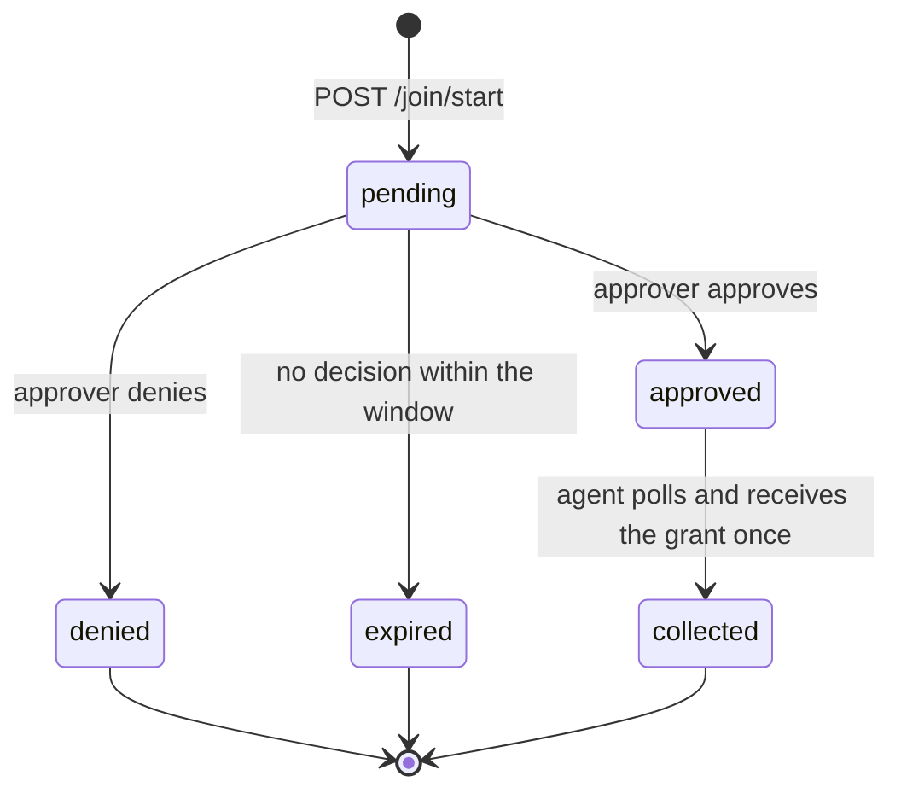
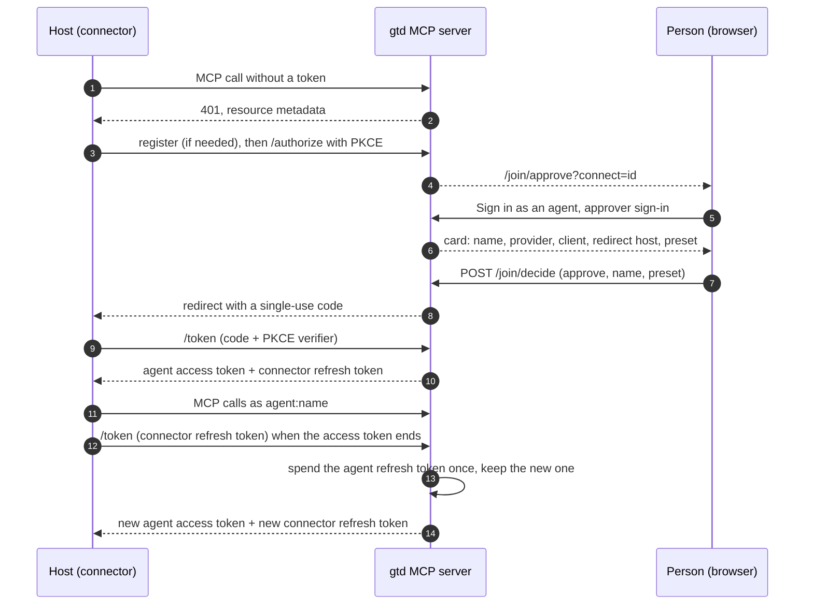

# 03. Agent join (server side)

The agent's side, including the exact wire shape of `/join/start` and `/join/token`, is
[agent sign-in](../knowledge/model/agent-sign-in.md). This page is what the server must do
behind it. A server that implements it is at the **Join** level.

## Two entrances, one agent record

There is one join with two entrances. Both end in the **same agent record**: name,
provider, preset, approver (stable id), approved at, approval end (30 days by default),
revoked at, last used, and `entrance` (`device-code` or `connector`).

| Entrance | For | Starts at | The agent ends up holding |
| --- | --- | --- | --- |
| Device code | Hosts that keep a file | `POST /join/start` | Its own access and refresh tokens, in a user-only file |
| Connector | Hosts that keep the sign-in for the agent (a hosted MCP connector, any MCP client doing OAuth) | The server's OAuth `/authorize` | Nothing: the host keeps the connector sign-in, the server keeps the agent's rotating refresh token |

Everything after the entrance is shared: the same approver rules, the same preset fence,
`/join/agents` lists both kinds, revoke and revoke-all end both, re-joining a name through
either entrance revokes the live record under that name, and `whoami` reports the
entrance. The device-code entrance is required at the **Join** level. The connector
entrance is optional and needs the server to run an OAuth sign-in for connectors
([transport and identity](transport-and-identity.md#three-kinds-of-caller)); a server that
offers it says so on `/join`.

## Switch

The join is off unless the operator lists at least one approver. With no approver listed,
every `/join/*` route answers that the join is off, and every existing joined-agent token
is refused. That one setting is the operator's emergency stop for all joined agents.

## Routes

| Route | Method | Who | Does |
| --- | --- | --- | --- |
| `/join` | GET | anyone | Plain-text steps for an agent, always current for this server, naming this server's own URLs. Carries one line `Entrances: <list>` (below), then which entrance to use and the steps for each |
| `/join/client.py` | GET | anyone | The join client (standard-library Python 3.9 or later). A server MAY serve the kit's reference client or its own; either must honour the client contract in agent sign-in |
| `/join/start` | POST | the agent | Opens a request; returns the device code, the short user code and the verification links |
| `/join/token` | POST | the agent | Polls a request, or renews with a refresh token |
| `/join/approve` | GET | approver | Shows one request: name, provider, machine, source address, requested preset, the user code. Signs the approver in first if needed. With `?connect=<id>` it shows a connector sign-in instead (below) |
| `/join/decide` | POST | approver | Approve (with a chosen preset, which may be lower than requested) or deny, for either entrance |
| `/join/agents` | GET | approver | Lists live agents with name, entrance, provider, preset, created, last used, approval end; never a hash or token |
| `/join/revoke` | POST | approver | Revokes one agent |
| `/join/revoke-all` | POST | approver | Revokes every agent and every pending request, after an explicit confirmation |

Route names are part of the contract (agents and people are sent to them).

The `/join` text MUST contain exactly one line of the form `Entrances: device-code` or
`Entrances: device-code, connector`, listing the entrances this server offers, so a client
or a conformance runner can tell without reading prose.

## Request lifecycle

- **Validation at start.** Name matches `^[a-z0-9][a-z0-9-]{1,38}[a-z0-9]$`; preset is one
  of the four; provider and machine are short free text and only ever displayed.
- **Limits.** The request lives 600 seconds. The poll interval is 5 seconds; a server SHOULD answer
  `slow_down` to polling faster than that. The server caps live pending requests (a small number, tens) and
  answers `slow_down` past the cap.
- **The user code** is 8 characters as `XXXX-XXXX` from an alphabet without look-alike
  characters. It is shown to the approver next to the request so they can match it with
  what the agent showed them. It is not a secret.
- **Collected once.** The grant is handed out on the first poll after approval and the
  request is then deleted. Until collection, a server that has to keep the grant keeps it
  encrypted, not in clear.
- **Same name.** Approving a name that already has a live agent revokes the old one.

## Approvers

- An approver signs in with an identity provider the operator chose (a GitHub sign-in is
  the natural one) and is matched by a **stable numeric account id**, not by a login or
  email that can be renamed or recycled.
- The approver's browser session is short (minutes), `HttpOnly`, `Secure`,
  `SameSite=Lax`, scoped to `/join`, and re-checked against the approver list on every
  request.
- Every state-changing form (decide, revoke, revoke-all) carries a CSRF token bound to the
  approver and the action.
- **No MCP tool can approve, deny or revoke.** An agent can never approve itself or another
  agent.

## Credentials

| Thing | Lifetime | Rule |
| --- | --- | --- |
| Access token | 24 hours (operator may change) | Opaque, at least 256 bits, with a fixed prefix; sent as the bearer on `/mcp` |
| Refresh token | 7 days if unused (operator may change) | Opaque, at least 256 bits, different prefix; **single use** |
| Approval | 30 days by default | Never extended by a renew. Both token expiries are clamped to it |

- The server stores tokens **only as hashes** (for example SHA-256) and looks the bearer up
  on every MCP call, so a revoke or expiry lands on the next call.
- **Renew** (`grant_type=refresh_token`) atomically marks the refresh token used and issues
  a new pair. The atomic step must hold across replicas (a transaction or a
  compare-and-set on the stored record).
- **Reuse is a leak.** A refresh token presented a second time revokes the whole agent,
  not just that token (RFC 9700, refresh token rotation), and answers `invalid_grant`.
- Every refused renew answers `invalid_grant`: approval ended, agent revoked, refresh token
  reused or expired. The agent then joins again; nothing else brings it back.
- Expired hashes are swept some time after they lapse.

## Revoke

- **Revoke one**: mark the agent revoked (who, when), delete its token hashes, and drop
  anything the server holds on that agent's behalf (for example a linked GitHub sign-in).
- **Revoke all**: the same for every agent, plus every pending request.
- Both are idempotent and logged with the approver's id.

## Connector entrance

Optional. The connector entrance is the server's ordinary OAuth 2.1 authorization-code
sign-in (PKCE, discovered through the RFC 9728 metadata), with the join's approval in the
middle. Clients need nothing special: a hosted connector that can sign in to any OAuth MCP
server can use it.

**Naming the agent.** The person gives the connector the address
`<mcp_url>/mcp?agent=<name>`. If the client sends that address as its RFC 8707 `resource`,
the server takes the name from it; otherwise the person types the name on the approval
card. The name follows the same pattern as a device-code join.

Requirements:

- **The choice.** `/authorize` sends the browser to `/join/approve?connect=<id>`. The page
  offers "Sign in as an agent". A server MAY also offer "Sign in as me", the connector
  identity sign-in from [transport and identity](transport-and-identity.md#three-kinds-of-caller),
  which stays a person's principal and is not a joined agent. The `connect` id is random,
  single use, and lives no longer than the OAuth transaction (about 15 minutes).
- **The card** shows the agent name (prefilled when known, editable), the provider (from
  the client's registered name), the client's registered name, the host the sign-in will
  be sent back to, the time, and the preset picker. It warns the person to approve only a
  connector they just added or reconnected themselves. The approver rules above apply
  unchanged: stable-id approvers, short session, CSRF token bound to the approver and that
  connect id.
- **Registration** accepts loopback redirect addresses (plain `http` to `localhost` or to
  the IPv4 or IPv6 loopback address, any port, RFC 8252 section 7.3) as well as `https` ones, so
  command-line clients can sign in.
- **The code** goes only to the redirect address the client registered, is single use
  (atomic across replicas), lives at most 5 minutes, is bound to the client and to the
  PKCE challenge, and carries the `state` back unchanged. A refused redemption (another
  client, a wrong verifier, a mismatched redirect) does **not** spend it; only a
  successful one does. A denial redirects with `error=access_denied`.
- **The tokens.** The token endpoint returns the agent's access token (the same kind and
  lifetime as a device-code join: opaque, prefixed, 24 hours, clamped to the approval) and
  a **connector refresh token** (opaque, its own prefix, bound to that OAuth client, never
  valid past the approval's end).
- **The agent's refresh token stays on the server.** The server keeps the agent's
  single-use refresh token, encrypted, with the connector grant, and never returns it to
  the client. A connector refresh spends it once and keeps the new one. Spending is one
  atomic step per grant generation, so two refreshes racing from the host return the same
  new access token and never present the agent refresh token twice (which would revoke
  the agent). A refresh while the current access token still has minutes left MAY return
  it unchanged.
- **The connector refresh token rotates** on every refresh (RFC 9700, section 4.14.2: the
  client may be public, so binding to a client id alone authenticates nothing). The
  replaced token gets the same answer as the refresh that replaced it for a short grace
  window (60 seconds by default), because a host may refresh from several sessions at
  once; presented after the window, it revokes the agent and answers `invalid_grant`.
- **Revoke.** Revoking the agent (one or all) deletes its connector grants, so the next
  connector refresh answers `invalid_grant` and the host asks the person to reconnect. A
  server SHOULD advertise a `revocation_endpoint` in its authorization-server metadata;
  where it does, a token revocation request (RFC 7009) for the connector refresh token
  revokes the agent.
  Re-joining the name through either entrance does the same to the old record.
- **Store.** The connector grant holds hashes and encrypted values only, like every other
  credential record.

## What the operator documents privately

The base URL, the approver ids, the identity provider's client, where the auth store
lives, and the emergency procedure (at minimum: removing every approver turns the join
off; revoke-all at `/join/agents` is the softer stop). Those belong in the deployment's
private repo, never in this kit.
