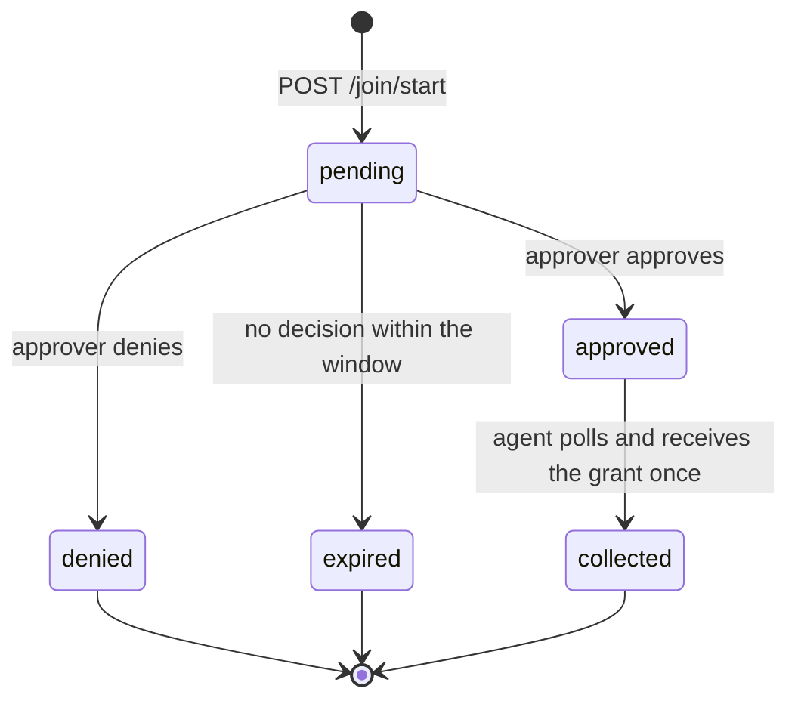

# 03. Agent join (server side)

The agent's side, including the exact wire shape of `/join/start` and `/join/token`, is
[agent sign-in](../knowledge/model/agent-sign-in.md). This page is what the server must do
behind it. A server that implements it is at the **Join** level.

## Switch

The join is off unless the operator lists at least one approver. With no approver listed,
every `/join/*` route answers that the join is off, and every existing joined-agent token
is refused. That one setting is the operator's emergency stop for all joined agents.

## Routes

| Route | Method | Who | Does |
| --- | --- | --- | --- |
| `/join` | GET | anyone | Plain-text steps for an agent, always current for this server, naming this server's own URLs |
| `/join/client.py` | GET | anyone | The join client (standard-library Python 3.9 or later). A server MAY serve the kit's reference client or its own; either must honour the client contract in agent sign-in |
| `/join/start` | POST | the agent | Opens a request; returns the device code, the short user code and the verification links |
| `/join/token` | POST | the agent | Polls a request, or renews with a refresh token |
| `/join/approve` | GET | approver | Shows one request: name, provider, machine, source address, requested preset, the user code. Signs the approver in first if needed |
| `/join/decide` | POST | approver | Approve (with a chosen preset, which may be lower than requested) or deny |
| `/join/agents` | GET | approver | Lists live agents with name, provider, preset, created, last used, approval end; never a hash or token |
| `/join/revoke` | POST | approver | Revokes one agent |
| `/join/revoke-all` | POST | approver | Revokes every agent and every pending request, after an explicit confirmation |

Route names are part of the contract (agents and people are sent to them).

## Request lifecycle

- **Validation at start.** Name matches `^[a-z0-9][a-z0-9-]{1,38}[a-z0-9]$`; preset is one
  of the four; provider and machine are short free text and only ever displayed.
- **Limits.** The request lives 600 seconds. The poll interval is 5 seconds; a server SHOULD answer
  `slow_down` to polling faster than that. The server caps live pending requests (a small number, tens) and
  answers `slow_down` past the cap.
- **The user code** is 8 characters as `XXXX-XXXX` from an alphabet without look-alike
  characters. It is shown to the approver next to the request so they can match it with
  what the agent showed them. It is not a secret.
- **Collected once.** The grant is handed out on the first poll after approval and the
  request is then deleted. Until collection, a server that has to keep the grant keeps it
  encrypted, not in clear.
- **Same name.** Approving a name that already has a live agent revokes the old one.

## Approvers

- An approver signs in with an identity provider the operator chose (a GitHub sign-in is
  the natural one) and is matched by a **stable numeric account id**, not by a login or
  email that can be renamed or recycled.
- The approver's browser session is short (minutes), `HttpOnly`, `Secure`,
  `SameSite=Lax`, scoped to `/join`, and re-checked against the approver list on every
  request.
- Every state-changing form (decide, revoke, revoke-all) carries a CSRF token bound to the
  approver and the action.
- **No MCP tool can approve, deny or revoke.** An agent can never approve itself or another
  agent.

## Credentials

| Thing | Lifetime | Rule |
| --- | --- | --- |
| Access token | 24 hours (operator may change) | Opaque, at least 256 bits, with a fixed prefix; sent as the bearer on `/mcp` |
| Refresh token | 7 days if unused (operator may change) | Opaque, at least 256 bits, different prefix; **single use** |
| Approval | 30 days by default | Never extended by a renew. Both token expiries are clamped to it |

- The server stores tokens **only as hashes** (for example SHA-256) and looks the bearer up
  on every MCP call, so a revoke or expiry lands on the next call.
- **Renew** (`grant_type=refresh_token`) atomically marks the refresh token used and issues
  a new pair. The atomic step must hold across replicas (a transaction or a
  compare-and-set on the stored record).
- **Reuse is a leak.** A refresh token presented a second time revokes the whole agent,
  not just that token (RFC 9700, refresh token rotation), and answers `invalid_grant`.
- Every refused renew answers `invalid_grant`: approval ended, agent revoked, refresh token
  reused or expired. The agent then joins again; nothing else brings it back.
- Expired hashes are swept some time after they lapse.

## Revoke

- **Revoke one**: mark the agent revoked (who, when), delete its token hashes, and drop
  anything the server holds on that agent's behalf (for example a linked GitHub sign-in).
- **Revoke all**: the same for every agent, plus every pending request.
- Both are idempotent and logged with the approver's id.

## What the operator documents privately

The base URL, the approver ids, the identity provider's client, where the auth store
lives, and the emergency procedure (at minimum: removing every approver turns the join
off; revoke-all at `/join/agents` is the softer stop). Those belong in the deployment's
private repo, never in this kit.
