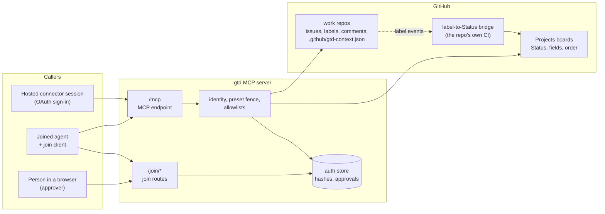

# 01. Architecture

## The idea in one paragraph

GitHub is the system of record. Work is an issue; its state is its labels, its board
fields, its card order, its open or closed state and a trail of structured comments. The
gtd MCP server owns **no** work state of its own. It is a gateway that (a) knows who is
calling, (b) decides what that caller may do, (c) does it on GitHub with a credential the
caller never sees, and (d) writes every claim and report as a record on the issue so that
any reader, including a different server, reaches the same answer.

## Roles

| Role | Who | What they can do |
| --- | --- | --- |
| **Operator** | Whoever runs the server | Configures the GitHub credential, the allowlists, the approvers, the identity provider; holds the emergency switch |
| **Approver** | A person the operator lists, identified by a stable account id | Approves, denies and revokes agent joins in a browser. Never an agent |
| **Person** | Someone who points agents at work and answers `needs:*` questions | Works in GitHub's own UI or API; their edits always win |
| **Agent** | A Claude, Codex or other runtime calling MCP tools | Exactly what its preset and the allowlists allow |

## Where state lives

| State | Lives in | Owned by |
| --- | --- | --- |
| Work items, labels, open or closed | GitHub issues | People and agents, through GitHub or the server |
| Claims, renewals, releases, reports | Structured comments on the issue ([claim-records](claim-records.md)) | The server writes them; any reader folds them |
| Status column, fields, card order | The repo's board | The bridge (Status from labels), people, and agents through board tools |
| Which profile and board a repo uses, server address | `.github/gtd-context.json` in the repo | The repo, by PR |
| Repo-specific rules | `.gtd/BOARD.local.md` in the repo | The repo, by PR |
| Join requests, approvals, token **hashes** | The server's auth store | The server |

The server MUST NOT keep a second copy of work state that could disagree with GitHub.
Caching for a single request is fine; caching across requests is not, because a person's
edit in the GitHub UI must be visible on the next call.

## The GitHub credential

The server acts on GitHub with a credential the operator configures. The spec does not fix
which kind. Common choices:

- a GitHub App installation token (recommended: scoped to the repos the App is installed
  on, short-lived, and needed for organisation boards anyway);
- a per-person user token obtained through an OAuth sign-in, so writes appear as that
  person (then the server must still stamp the agent's principal on every record, because
  GitHub alone can no longer tell agents apart).

Whatever the choice: the caller's MCP token is never forwarded to GitHub, no tool returns a
GitHub token, and no tool takes an identity argument.

## Allowlists

The operator configures two allowlists and the server fails closed on both:

- **repos**: `owner/repo` entries, with `owner/*` allowed for a whole owner;
- **boards**: `owner/number` entries.

A call naming a repo or board outside the list is refused before any GitHub call. A server
MAY also have a default repo and a default board for calls that omit them; the kit always
passes `repo` and `project`, so defaults are a convenience, never relied on.

## The label-to-Status bridge

Moving a board card when a label changes is **not** the server's job. Each repo carries a
bridge (normally a workflow in its own CI) that reads the label-to-Status map
([repo-context-and-profiles](repo-context-and-profiles.md#the-label-to-status-map)) and sets Status. Agents
change labels; the bridge moves the card. In a repo without a bridge, agents set Status
themselves with `project_set_status`, which is why the Board level exists.

A server MAY ship a bridge, run one as a webhook consumer, or do neither. It MUST NOT fight
a bridge: tools that change labels do not also set Status.
