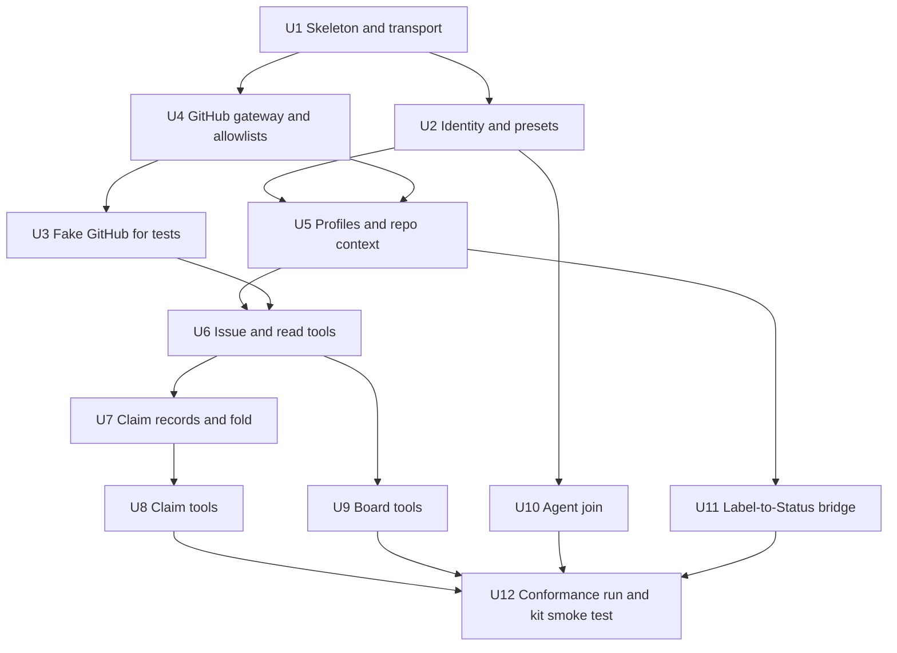

# 09. Work plan: building a server unit by unit

This cuts the spec into units a coding agent can take one at a time. Each unit is one
reviewed pull request: it names the spec sections it implements, what it depends on, what
it delivers, and the conformance checks that prove it. Build in the order given; units on
the same row of the graph can run in parallel.

Choices left to you (write them down in your own repo before unit U1): language and MCP
library, hosting, the auth store (anything with an atomic compare-and-set), the connector
identity provider, and the GitHub credential (an App is recommended).

| Unit | Implements | Delivers | Proven by |
| --- | --- | --- | --- |
| **U1 Skeleton and transport** | [transport-and-identity](transport-and-identity.md#endpoint-and-transport) | A server answering MCP over stateless Streamable HTTP at `/mcp`, a health route, configuration from the environment, structured logging with secret redaction, a test harness that drives the app in process | T2, X1 (harness) |
| **U2 Identity and presets** | [transport-and-identity](transport-and-identity.md#three-kinds-of-caller), [security](security.md) S1, S2, S7 | Chained bearer verifiers (connector OAuth with RFC 9728 metadata and an identity allowlist; a stub for joined agents that U10 fills in), the principal, the preset fence middleware, a single tool-class table, `whoami`, the spec-version document at `/.well-known/gtd-board-kit` | T1, T4, T5, T6, T7, T8, X2 |
| **U3 Fake GitHub** | [conformance](conformance.md) | An in-memory GitHub: repos, issues, labels, comments with increasing ids, comment delete, issue dependencies, one board with fields, options, manual order and views; can inject failures | used by U6 to U9 |
| **U4 GitHub gateway and allowlists** | [architecture](architecture.md#the-github-credential), [architecture](architecture.md#allowlists), S6, S8 | One module every tool goes through: resolves `repo` and `project` against the allowlists, gets a credential, never exposes it, maps GitHub errors to one-line refusals | P5 |
| **U5 Profiles and repo context** | [repo-context-and-profiles](repo-context-and-profiles.md) | The profile catalogue as data, its loader and validator, reading `gtd-context.json` through the gateway, `profile_list`, `profile_get` | P1, P2, P3 |
| **U6 Issue and read tools** | [tools](tools.md#identity-and-context), [tools](tools.md#finding-work), [tools](tools.md#issues) | `list_next_actions`, `issue_list`, `issue_blocked_by_list`, `project_get`, `project_items`, `project_item_find`, `project_views_list`, `capture`, `issue_comment`, `issue_labels` | P4, P6, P7, C11 |
| **U7 Claim records and fold** | [claim-records](claim-records.md) | Pure functions, no I/O: render a record, parse a comment, fold a list of comments; lease parsing | C9, C10, C13 |
| **U8 Claim tools** | [claim-records](claim-records.md#claiming-safely-without-a-lock), [tools](tools.md#claims-and-reports) | `item_get`, `item_claim`, `item_renew`, `item_release`, `item_report`, the board mirror | C1 to C8, C12 |
| **U9 Board tools** | [tools](tools.md#level-board) | `project_add_item`, `project_set_status`, `project_set_field`, `project_item_move`, `project_item_archive`, `project_status_update`, the draft tools; `project_report` | B1 to B4 |
| **U10 Agent join** | [agent-join](agent-join.md), S3 to S5, S15, S17 | The `/join/*` routes and pages, the auth store, token issue, hash lookup, renew with reuse detection, revoke and revoke-all, approver sign-in, CSRF; the joined-agent verifier U2 stubbed. Optionally the connector entrance: wrap the connector OAuth sign-in so `/authorize` goes through `/join/approve`, issue codes and connector refresh tokens, keep the agent refresh token server-side | J1 to J11; JC1 to JC9 when offered |
| **U11 Label-to-Status bridge** | [repo-context-and-profiles](repo-context-and-profiles.md#the-label-to-status-map) | A bridge a repo can run (a workflow plus a script, or a webhook consumer) that applies the map with its six rules | its own tests for the six rules |
| **U12 Conformance and smoke** | [conformance](conformance.md) | The full suite green in CI; a scratch repo with the kit, a joined agent, and the smoke test in "Running against the kit" | all checks of the levels claimed, and T9 |

## Brief for a coding agent taking a unit

Give the agent this, filled in:

> Build unit `<U-n>` of the gtd MCP server described in
> `https://github.com/dandelion-love/gtd-board-kit/tree/main/server-spec`. Read the README,
> then the sections the unit's row names, then [security.md](security.md). Our
> choices: `<language, MCP library, hosting, auth store, identity provider, GitHub
> credential>`. Units already merged: `<list>`. Deliver one PR with code and the tests for
> the checks the row names, against the fake GitHub. Do not widen the unit; anything you
> find missing in the spec, write down in the PR as a question.

## Definition of done for every unit

- The checks the row names pass in CI, and earlier units' checks still pass.
- No secret, token or deployment detail in code, tests or logs; configuration comes from
  the environment.
- The PR says which spec sections it implements and any place it had to interpret them.
